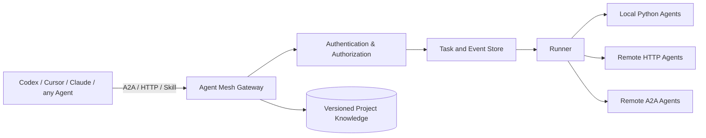

# Open Agent Mesh

[中文说明](README.zh-CN.md) · [Architecture](docs/ARCHITECTURE.md) · [Roadmap](docs/ROADMAP.md)

**Framework-neutral Agent-to-Agent collaboration infrastructure.**

Open Agent Mesh aims to let authorized AI agents coordinate across frameworks, machines and users through open protocols rather than requiring a proprietary product. It builds around **A2A**, familiar **HTTP JSON**, **Agent Skills**, persistent tasks, permissions and project-shared knowledge. MCP integration and higher-level coordination are planned.

> **Status: v0.1 MVP / research prototype.** It implements a subset of A2A 1.0 JSON-RPC, not a conformance-certified full A2A server, and is not associated with Cursor. Integration with ChatGPT, Codex, Cursor or Claude requires each host application's supported tool, skill or API permissions.

## Principles

1. **Protocol-agnostic core**: A2A for peer-to-peer tasks; MCP for connecting tools; generic HTTP for interoperability.
2. **Agent autonomy with explicit authorization**: capability discovery, granular scopes, approval gates for consequential actions.
3. **Shared project context**: versioned facts, decisions, evidence and conflict protection.
4. **Auditable orchestration**: persistent task status, idempotency, event journal, safe delegation and traceability.
5. **Open core and portable deployments**: local-first development, cloud-ready infrastructure and neutral SDKs.
6. **Security first**: distrust peer messages; isolate identities, credentials and tenant contexts.

## v0.1 architecture



The local MVP includes task registration and dispatch, agent metadata, A2A JSON-RPC subset, SQLite persistence, per-principal token and project scopes, shared knowledge revisions, demo agents, Python/Node clients and a portable SKILL.md. **It does not yet provide production-grade distributed scheduling, full A2A, SSE, MCP integration, OIDC/mTLS, multi-tenant security or robust remote cancellation.**

## Quick start (after source is populated)

Requires Python 3.10+.

```bash
python3 -m venv .venv
source .venv/bin/activate
pip install -e '.[dev]'
export MESH_TOKENS='{"development-token":{"name":"dev","role":"admin","allowed_agents":["*"]}}'
export MESH_TOKEN=development-token
agentmesh
```

Local API documentation: http://127.0.0.1:8765/docs

**Development tokens are only for local testing. Never expose them on a public network.**

```bash
PYTHONPATH=src pytest -q
PYTHONPATH=src python tests/smoke_network.py
```

## Long-term research

Research tracks: protocol compatibility and conformance; secure multi-agent messaging; durable DAG orchestration; shared and private agent memory; multi-tenant isolation; human-in-the-loop approvals; MCP and SDK adapters; observability; billing and commercial deployment.

The repository is the **single source of truth** for future code and research changes. Record functional changes in [CHANGELOG.md](CHANGELOG.md), architectural decisions in versioned docs, and use tests/PR review before merging.

## Open source and commercial direction

The current code is MIT licensed. Commercial opportunities—including hosted gateways, enterprise security, cross-team coordination, policy and audit, and metering—are **hypotheses for validation**, not revenue claims. Do not include secrets, client data, or third-party proprietary code in public commits.

## Background

Inspired by open Agent-to-Agent collaboration patterns and the 2026 Cursor Projects multiplayer discussion. This repository contains an independent implementation, not Cursor internal code.

- A2A: https://a2a-protocol.org/
- MCP: https://modelcontextprotocol.io/
- Cursor Projects: https://cursor.com/blog/projects-multiplayer
