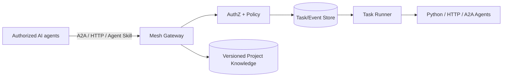

# Open Agent Mesh

[中文说明](README.zh-CN.md) · [技术指南](docs/TECHNICAL_GUIDE.md) · [Architecture](docs/ARCHITECTURE.md) · [Roadmap](docs/ROADMAP.md) · [Project Charter](docs/PROJECT_CHARTER.zh-CN.md)

**Framework-neutral Agent-to-Agent collaboration infrastructure.**

Open Agent Mesh aims to let authorized AI agents coordinate across frameworks, machines and users through open protocols rather than requiring a proprietary product. It builds around **A2A**, familiar **HTTP JSON**, **Agent Skills**, persistent tasks, permissions and project-shared knowledge. MCP integration and higher-level coordination are planned.

> **Status: v0.1.0 MVP / research prototype.** Implements a subset of A2A 1.0 JSON-RPC, not a certified full A2A server, and is independent of Cursor. ChatGPT, Codex, Cursor and Claude integration depends on each host application's supported tools, skills or APIs.

## Core capabilities

- Agent registry with explicit, configured capabilities
- Basic A2A 1.0 JSON-RPC bridge and HTTP JSON adapters
- Durable local task records, status, events and idempotency
- Scoped bearer access policy, permitted agents and projects, delegation depth limit
- Shared versioned project knowledge with conflict detection
- Portable Agent Skill, Python and Node.js demos, lightweight coordinator example
- Dockerfile, local unit tests and cross-process networking smoke test

**Not yet production grade:** distributed scheduling, true remote-side effect cancellation, full A2A streaming/push methods, robust authentication, multi-tenant isolation, signed Agent Cards, secure artifact store, a native MCP server and autonomous planner.

## Architecture



## Run locally

Requires Python 3.10+.

```bash
python3 -m venv .venv
source .venv/bin/activate
pip install -e '.[dev]'
export MESH_TOKENS='{"development-token":{"name":"dev","role":"admin","allowed_agents":["*"]}}'
export MESH_TOKEN=development-token
agentmesh
```

Swagger docs: http://127.0.0.1:8765/docs

Use demo credentials **only** on an isolated development machine, never on public networks. See [Technical Guide](docs/TECHNICAL_GUIDE.md) and [Chinese setup guide](README.zh-CN.md).

## Verify

```bash
PYTHONPATH=src python -m pytest -q
PYTHONPATH=src python tests/smoke_network.py
```

The local MVP passed 24 core tests and cross-process Python/Node/Skill smoke tests; GitHub Actions runs test suite on push/PR. A self-to-self gateway round-trip does not establish official A2A 1.0 conformance.

## Long-term research and commercial development

Current priorities: [Issue #1](https://github.com/keyneszeng/Open-Agent-Mesh/issues/1) interoperability; [#2](https://github.com/keyneszeng/Open-Agent-Mesh/issues/2) security; [#3](https://github.com/keyneszeng/Open-Agent-Mesh/issues/3) durable orchestration; [#4](https://github.com/keyneszeng/Open-Agent-Mesh/issues/4) MCP/Skills; [#5](https://github.com/keyneszeng/Open-Agent-Mesh/issues/5) project memory; [#6](https://github.com/keyneszeng/Open-Agent-Mesh/issues/6) commercial validation.

See [research on Cursor Agent collaboration](docs/RESEARCH_CURSOR_AGENT_COLLABORATION_2026-11-11.zh-CN.md), [commercial hypotheses](docs/COMMERCIAL_HYPOTHESES.zh-CN.md), and [roadmap](docs/ROADMAP.md).

The current code is MIT licensed. Hosted gateways, enterprise controls, audit, governance and usage billing are research/market hypotheses, **not existing features or proven revenue**.

## Contribution rules and change tracking

The GitHub repository is the single source of truth. Contributors and AI agents must follow [AGENTS.md](AGENTS.md) and [CONTRIBUTING.md](CONTRIBUTING.md), add tests and update [CHANGELOG.md](CHANGELOG.md) with every meaningful change, and use Issues and PRs for reviewable work. No background development or automatic repository updates occur unless corresponding automation is configured and running.

## Sources and inspiration

Independent implementation inspired by open agent collaboration patterns and Cursor Projects multiplayer ideas; it is **not** Cursor proprietary source code.

- A2A: https://a2a-protocol.org/
- MCP: https://modelcontextprotocol.io/
- Cursor Projects: https://cursor.com/blog/projects-multiplayer

**License:** MIT.
