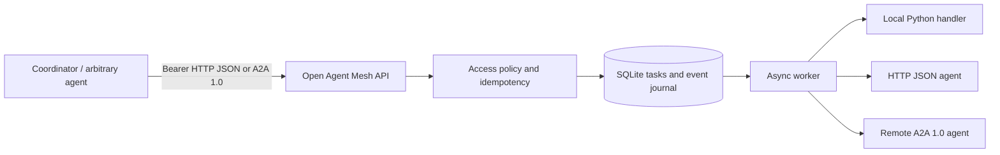
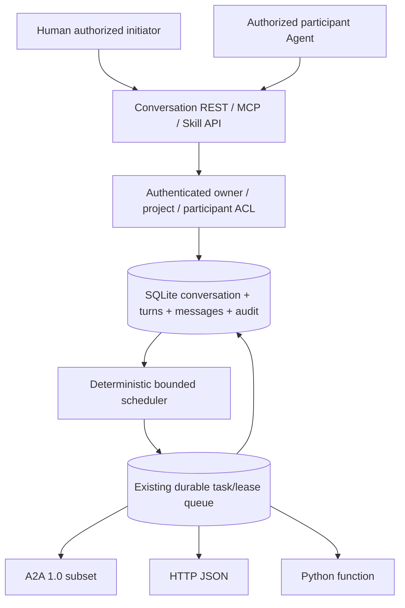
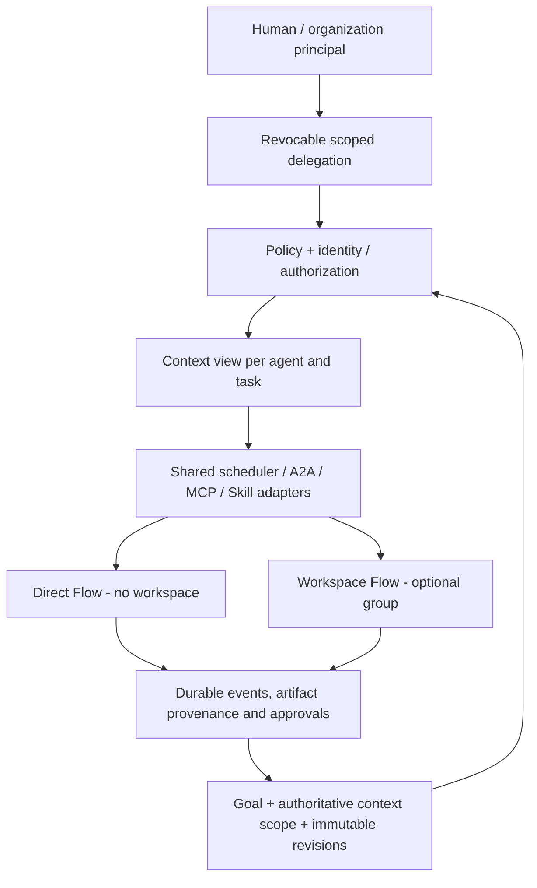

# Architecture and threat model (v0.3)

- *Discovery*: `GET /v1/agents` (authorized) and per-agent public Agent Cards.
- *Delegation*: HTTP task with destination, context, parent ID; fixed-depth recursion bound.
- *Durability*: sqlite stores submitted, working, completed, failed and canceled tasks. Expired `working` leases are atomically re-queued by the next claim; an active lease is not stolen just because another instance initialized. External replay remains possible.
- *Authorization*: one opaque bearer credential per principal; `allowed_agents` controls dispatch; owner scopes task retrieval.
- *Secret handling*: remote auth token only read from environment; never store remote token in task body. Context is passed through verbatim; caller must exclude secrets.
- *Shared knowledge*: Project-scoped facts with optimistic concurrency and complete revisions; all explicitly authorized project members can read them.
- *Audit*: recorded task state transitions without user input/body. Tasks themselves do store input and output, unencrypted on disk; use disk encryption and retention policy.
- *Conformance*: this gateway implements a **partial** A2A 1.0 JSONRPC binding. Unsupported protocol operations are explicitly rejected.

## Deliberate constraints

1. No public URL registration: prevents unauthenticated clients turning the gateway into a general-purpose SSRF proxy.
2. No uncontrolled agent tool execution from natural-language prompts: only configured destinations are callable.
3. No default authorization token: missing `MESH_TOKENS` aborts startup.
4. No implicit access to one another's private memory, prompts, credentials or files.
5. Single-process DAG scheduler, four in-flight tasks per process. SQLite task claims have leases but multi-process DAG coordination remains unsupported; external side effects may run twice after a crash.

## Missing before Internet/public production

Externalized identity (OIDC / mTLS); multi-tenant isolation; quotas and rate limits; durable work leases and retry/DLQ; per-action human approvals; secure artifact storage; TLS; signed/verifiable Agent Cards; network egress policy; DNS pinning; full A2A SDK compliance testing; observability/tracing; payload size limit at reverse proxy; prompt-injection protections in delegated content; test against third-party agent implementations.

## v0.2 persisted coordinator

`WorkflowEngine` records explicit DAGs in `workflows`, `workflow_steps`, and `workflow_events` alongside the existing task journal. One background loop polls DAGs and submits ready steps via the same authenticated task storage path, with deterministic workflow step attempt idempotency keys. Deployed as a single process; **do not enable multiple server worker processes**. A crash between an external agent effect and task status persistence can still cause replay. Only project facts explicitly named by `fact_keys` are copied (revision-pinned) into a step context. Legacy `allowed_projects` grants editor access; fine-grained `project_roles` supports reader/editor. Store content is not encrypted at rest.

## v0.3 upgrade slice

SQLite claims now use expiry + fencing tokens and heartbeat; sqlite connections are closed rather than merely committed. Human-gated agents are configured server-side and do not accept direct tasks. A partial MCP 2026-07-28 JSON-response bridge shares the existing bearer token ACL. Reviewers must be a different principal from the workflow owner and have explicit review authority. A review token must NOT be accessible from Agent code. See [v0.3 reliability details](RELIABILITY-v0.3.zh-CN.md) and [test plan](TEST_PLAN-v0.3.zh-CN.md).

## v0.4 Conversation Engine

Conversation turns use stable idempotency keys, avoid arbitrary LLM tool execution, and stop auto relay on failed worker tasks. Only a human principal can initiate a bounded autonomous discussion or close the conversation. Agent claims are derived from bearer credential `agent_id`, not user-supplied role. See [conversation specification](CONVERSATIONS-v0.4.zh-CN.md).

## Future architecture decision (ADR-0002, proposed implementation)

The existing v0.5 project-fact and conversation stores are **not yet a complete unified Context Engine**. The following is the approved target, not a claim of implemented features.

**Contract:** direct and workspace workflows share `goal_id`, `context_scope_id`, a pinned context revision, identity, delegation, task execution policy, artifacts and event journal. A workspace is optional and does not become the authority for project facts. A conversation is not a permission grant. Users must approve adding existing direct-flow context to a workspace and authorize each new member's visibility.

Identity chain for externally-effectful work: authenticated `principal_id` → restricted `delegation_id` → `agent_instance_id` → `task_id` → auditable artifact. Human/org is accountable, but the Agent is not necessarily exclusively owned by a single person.

**Data minimization:** server constructs a least-privilege `ContextView` for each task. Untrusted tool output, Agent dialogue and proposed edits cannot override global policy; user-private memory is not shared by default. Optimistic concurrency/version pinning and retrospective provenance are required.

See [ADR-0002](adr/0002-context-first-dual-mode-and-human-delegation.md). No goal/context_scope/workspace/authority delegation API is currently implemented; continue to treat v0.5 as a single-replica prototype.
