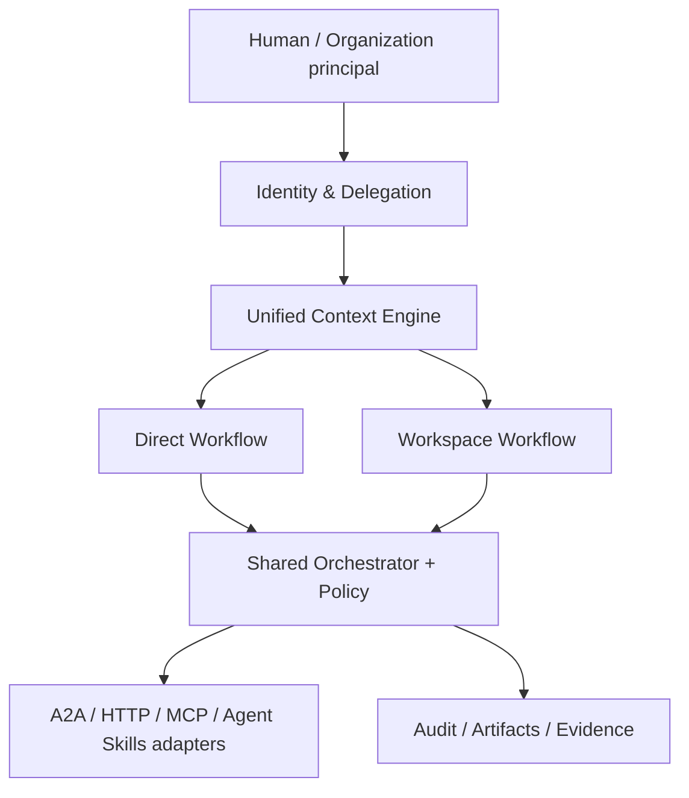

# Open Agent Mesh v0.6 研发规格：统一上下文与双模式协作

**状态：** 设计通过，尚待编码和验证  
**时间：** 2026-11-11  
**架构决策：** [ADR 0002](adr/0002-unified-context-dual-workflows.md)

## 产品定义

Open Agent Mesh 是以人类授权与共同目标为基础、以统一上下文为工作约束、通过开放通信协议协调不同类型 Agent 的通用协作基础设施。两种模式同根同源：

1. **Direct Workflow（无群/无工作区）**：一次请求驱动按需委派，Agent A → Agent B → Agent C；适合短链路、API 和事件触发。
2. **Workspace Workflow（有群/有工作区）**：长期目标、组织成员与专业 Agent 持续分工、讨论、验收；适合项目制交付。

不同模式只决定组织/可见性，不决定不同底层协议。**工作区可选，目标与约束上下文不可选。**

## 分层

## 设计对象与关键字段（拟议）

| 对象 | 必需标识/字段 | 约束 |
| --- | --- | --- |
| Principal | `principal_id`, type, verified identity | 人类/组织承担授权和责任 |
| AgentIdentity | `agent_id`, adapter, principal relationship | Agent 不等于人，不能自行声明权限 |
| Grant | `grant_id`, principal, agent, scopes, expires, revoked | 可撤销，委派权限只能收窄 |
| Goal | `goal_id`, owner, success criteria, status | 执行统一入口 |
| ContextBundle | `context_id`, `revision`, rules, facts, decision refs | 版本不可变；按权限投影 |
| Workflow | `workflow_id`, `goal_id`, `context_revision`, optional `workspace_id` | 两种模式同一个调度器 |
| Workspace | `workspace_id`, members, roles, linked goals | 不创建第二种引擎 |
| Message/Event | actor, role, goal, context revision, task ref, time | 来源可审计，默认不可信 |
| Artifact | owner, integrity hash, ACL, provenance, approval state | 交付证据不可静默替换 |

## 核心流程

**Direct**：校验人类授权 → 创建 Goal + Context 快照 → 生成带最小权限视图的任务 → Agent 之间继续委派 → 审计 → 人类/规则验收结果。

**Workspace**：创建工作区并授予成员角色 → 绑定 Goal + 同一 Context Engine → 多 Agent 各自领取/分配职责 → 流式交流并协调依赖 → 统一验收、归档。

**Direct → Workspace**：管理员/目标所有者明确授权后，将现有 Goal/Run 关联工作区，不改变既有任务与上下文版本，保留所有审计链。不能因此扩大执行权限。

## v0.6 最小交付切片

- M1：正式 Goal 和 ContextBundle 模型、版本 CAS、上下文视图与 provenance。
- M2：HumanPrincipal / AgentIdentity / DelegationGrant（明确角色、授权时效、撤销和审计）。
- M3：统一 Workflow API 可接受 `workspace_id = null`，并提供 workspace 成员管理；共用执行/审批/租约。
- M4：授权下的 Direct → Workspace 关联、上下文版本冻结、权限收窄。
- M5：跨进程 A2A/HTTP/Skills 示例与可重复自动测试、GitHub CI 证据。

## 多轮测试矩阵（待执行，不能计为已通过）

| 测试 | 通过条件 |
| --- | --- |
| T01 直连工作流 | 无 workspace 仍完整执行并保留上下文标识 |
| T02 工作区工作流 | 多 Agent/成员角色下能讨论、并行、交付 |
| T03 上下文一致性 | 两种模式取得相同权威 revision，投影内容按权限不同 |
| T04 并发版本冲突 | 两名 Agent 更新同一 revision 只有一个成功，其余显式冲突 |
| T05 委派越权 | 子 Agent 不能继承父 Agent 没有的权限 |
| T06 权限撤销 | 撤销后新请求失败、旧操作限制和审计可观察 |
| T07 角色冒充 | Agent 不能声明自己为审批者/用户 |
| T08 高风险操作 | 缺少授权或人工审批时操作不会执行 |
| T09 提升到工作区 | 既有 Goal/Run/task/audit/context revision 不丢 |
| T10 崩溃恢复 | 任务租约过期恢复，只有一个最终交付记录 |
| T11 故障注入 | 网络超时、掉线、消息重放和幂等性可验证 |
| T12 回归与兼容 | v0.1–v0.5 的现有测试全部继续通过 |
| T13 流量/成本 | 限制轮次、请求大小、预算，防无限循环 |
| T14 多租户隔离 | 不同主体/工作区不能读取彼此私有资源 |

分批执行：单元 → API/ACL → 跨进程 → 随机化/并发 → SIGKILL/网络故障 → GitHub 多 Python 版本 CI。所有结果附实际运行日志，失败明确标红，不以设计文档代替实现。

## 非目标与安全边界

- 不宣称所有 ChatGPT/Cursor/Claude 商业客户端自动加入，必须有厂商官方许可接口和授权。
- 不是放开所有 Agent 的任意代码执行权限，也不是一个“群主超级权限”。
- 不默认上传私人聊天记录、凭证和组织内部知识到工作区。
- 不宣称 v0.6 已生产可用；本文件是未来实现与测试验收合同。
